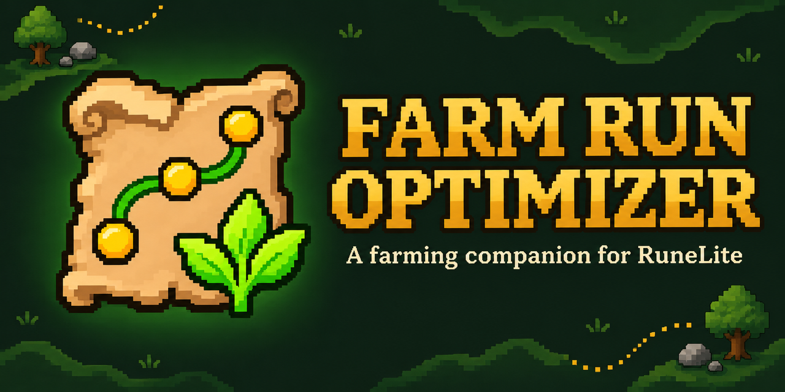

  

  
  
  

  <b>Plan every herb, tree, fruit tree and hardwood run: what to bring, the fastest route, what to do at each patch, and every growth timer.</b> 
  Made by ToadFx

---

## Highlights

| | |
|---|---|
| **Smart route** | Fastest teleports you own, fairy rings chained back to back with the code to dial, spells or tabs your choice. |
| **Take with you** | One list of seeds, saplings, compost, payments, runes and tools. Bank stops added when it won't fit. |
| **Step by step** | A card for every patch with its to-do list. The item you need next is highlighted in your inventory. |
| **Exact timers** | Read straight from the game, including your account's growth-tick offset. Notifications when ready. |
| **Your picks** | Choose which herbs and trees to plant and which patches to visit. |

> Screenshots coming soon.

## What it does

- **Four run types.** Tick Herbs, Trees, Fruit trees and/or Hardwood at the top of the panel.
  They combine into one route.
- **Take with you.** One grid of everything for the run: seeds, saplings, compost, gardener
  payments (noted is fine), coins, tools, teleport items and spell runes. Green border =
  carrying it, orange = still in the bank. Matching items are outlined in your bank.
- **Bank stops.** If it won't all fit in 28 slots (saplings and compost buckets add up fast),
  the route gets a bank stop at the nearest bank, with exactly what to withdraw there.
- **Stop cards.** Every stop shows the teleport and directions, then a to-do list for that
  patch: harvest, check health, pay the gardener to clear it, dig up a stump, plant, compost,
  pay protection. The next stop is outlined in **gold**; finished stops drop off the list.
- **Where to go.** The next patch is outlined on the ground with the hint arrow, and the
  Shortest Path plugin (Plugin Hub) draws the walking line if it's installed.
- **Fairy rings** are picked automatically when faster and chained back to back, e.g.
  Ardougne cloak > walk to **BLR** > dial **ALQ** > **AKR** > **AJP**. Each stop says which code
  to dial. Codes: BLR, ALQ, AKR, CIR, AJP, AIS, CIQ.
- **Pick your crops and patches.** Each run in the **Runs** section lists every crop (locked ones show their level) and every patch (locked ones greyed). Click to untick any you don't want.
- **Spells / tabs** checkboxes in the Travel section; tick **Show all travel methods** to see every item, tab, spell and fairy ring with what unlocks it. With both on, a spell is used wherever
  you can cast it and a tab only where you can't. Click any teleport item to stop using it.
- **Timers** for every patch, from three sources:
  1. The "You plant..." message.
  2. **Being near a patch**: its exact state is read from the game (growing stage, ready,
     needs chopping, stump, diseased, dead, weeds), the same way RuneLite's Time Tracking does.
     The plugin also learns your account's farming tick offset so countdowns are exact.
  3. **Time Tracking import**: patches RuneLite's built-in Time Tracking has already seen.
- **Only ready patches.** If one herb is ready, the run is just that patch; growing ones are left off with a "next up" time.
- **Notifications** when a patch finishes growing, and when a patch is diseased or dead (plant cure / secateurs are added to the bank list).
- **Run-ready box.** A small on-screen box: "Herbs 3 of 6 ready", "Trees in 1h 20m", diseased patches and your contract.
- **Profit.** Each run's harvest is logged with Grand Exchange prices; the Run history shows profit per run and your average herbs per patch.
- **Most profitable herb first.** The Herbs run shows profit per patch for each herb you can grow and plants the best one first.
- **Farming contracts.** Your Farming Guild contract is shown, and the contract crop is planted in the guild patch.

## Testing it

You can't drop it into normal RuneLite. It runs in a developer-mode RuneLite launched from
the project.

1. Install **IntelliJ IDEA Community** and **Java 17** (Eclipse Temurin).
2. One-time Jagex account setup: open **RuneLite (configure)**, add
   `--insecure-write-credentials` to Client arguments, launch RuneLite once from the Jagex
   Launcher, close it. Keep `.runelite/credentials.properties` private and delete it when done.
3. Open this folder in IntelliJ (File > Open > `build.gradle` > Open as Project).
   Set File > Project Structure > SDK to 17 and Settings > Gradle > Gradle JVM to 17.
4. Gradle tab (elephant, right edge) > farm-run-optimizer > Tasks > application > **run**.
5. Log in, click the logo in the sidebar, and **open your bank once**.

## Patches

| Type | Patches |
|---|---|
| Herbs | Falador, Catherby, Ardougne, Morytania*, Hosidius, Farming Guild (65), Varlamore*, Troll Stronghold*, Weiss*, Harmony Island* |
| Trees | Varrock, Lumbridge, Falador, Taverley, Gnome Stronghold, Farming Guild (65), Nemus Retreat* |
| Fruit trees | Gnome Stronghold, Tree Gnome Village, Catherby, Brimhaven, Lletya*, Farming Guild (85), Kastori* |
| Hardwood | Fossil Island x3*, Locus Oasis* |

\* needs a quest or diary, detected automatically (Harmony Island: tick "Morytania Elite done"
in settings).

## Files

- `FarmPatch.java` patches, route order, exact regions/varbits, teleports and directions
- `Crop.java` crops, levels, growth stages, gardener payments
- `Teleport.java` teleports and what unlocks them
- `RunPlanner.java` route, teleports, fairy chain, supplies, bank stops (no RuneLite code)
- `StopWork.java` the to-do list on each stop card
- `PatchStates.java` + `patch-states.tsv` reading a patch's state from the game
- `GrowthClock.java` countdown maths and tick-offset learning
- `PatchTimers.java` timers and saving
- `HerbRunPlugin.java` connects it all to the game

Progress and what's next: [PROGRESS.md](PROGRESS.md). Changes: [CHANGELOG.md](CHANGELOG.md).
- `HerbRunPanel.java` sidebar; `PatchNavigationOverlay.java` ground highlight;
  `HerbRunBankOverlay.java` bank highlight

## Credits

- **[RuneLite](https://github.com/runelite/runelite)**: patch states, regions, varbits and growth
  stages come from RuneLite's Time Tracking plugin. `scripts/generate_patch_states.py` rebuilds
  the table from RuneLite's source and `scripts/verify_patches.py` checks every patch against it.
- **[Old School RuneScape Wiki](https://oldschool.runescape.wiki/)**: items, payments, growth
  times, teleports, directions and fairy ring codes.

Farm Run Optimizer is released under the [BSD 2-Clause License](LICENSE). Licenses and full attributions: [NOTICE](NOTICE). Old School RuneScape is a trademark of
Jagex Ltd; this plugin is not affiliated with or endorsed by Jagex.
